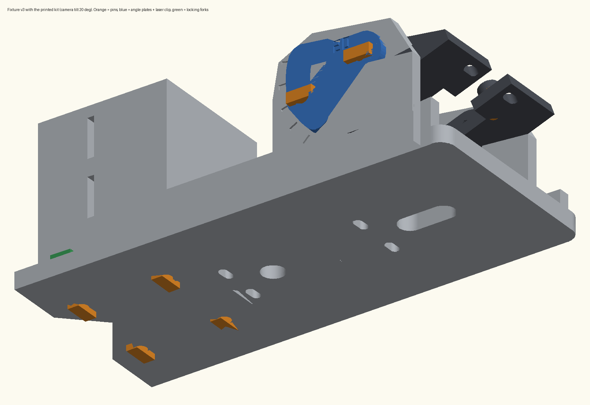

# Welding Sensor Fixture v3 - Print and Assembly Guide

Camera + line laser on a robot MIG torch. All fasteners are 3D-printed: no screws, nuts or hose clamps needed.

## 1. What to print

| File | How many | What it does |
|---|---|---|
| `1_fixture_parts_ALREADY_PRINTED/base.stl` | 1 | Base plate with camera cheeks and laser holder (already printed) |
| `1_fixture_parts_ALREADY_PRINTED/camera_yoke.stl` | 1 | Tilting camera holder (already printed) |
| `1_fixture_parts_ALREADY_PRINTED/arm_clamp.stl` | 1 | Clamp block that sits on the torch neck (already printed) |
| `2_print_pins_clips_straps/camera_pin.stl` | 6 (4 + 2 spare) | Hold the camera board on its 4 posts |
| `2_print_pins_clips_straps/yoke_pin.stl` | 6 (4 + 2 spare) | Camera tilt: 2 pivot pins + 2 lock pins |
| `2_print_pins_clips_straps/block_pin.stl` | 5 (4 + 1 spare) | Join the clamp block to the base plate |
| `2_print_pins_clips_straps/block_fork_side.stl` | 3 (2 + 1 spare) | Lock the 2 block pins near the V (side slots) |
| `2_print_pins_clips_straps/block_fork_rear.stl` | 3 (2 + 1 spare) | Lock the 2 block pins at the back (back-face slots) |
| `2_print_pins_clips_straps/laser_clip_size2.stl` | 1 | Holds the laser (size 1 = thinner laser, size 3 = thicker laser) |
| `2_print_pins_clips_straps/strap_short.stl` | 2 | Strap the fixture to the torch neck (neck 16-35 mm thick) |
| `2_print_pins_clips_straps/strap_long.stl` | 2, only if needed | For a thick torch part (35-65 mm). Print diagonally on a 220 x 220 bed. |
| `3_print_angle_plates/angle_plate_XXdeg_RIGHT.stl` | 1 | Locks the camera angle, right cheek |
| `3_print_angle_plates/angle_plate_XXdeg_LEFT.stl` | 1 | Locks the camera angle, left cheek (mirror of RIGHT) |

laser_bar.stl is NOT needed. The printed laser clip replaces it. (It is kept in 6_optional_metal_screws/ for the screw version.)

### Print settings

- Material: PETG is best. PLA works but is more brittle, so print the spares.
- Layer height 0.2 mm (0.12-0.16 mm for the small pins if possible).
- 100% infill and 4 walls for every part in folders 2 and 3.
- No supports. Every STL is already lying in its correct print orientation. Do not rotate or scale.
- Print small pins several at a time so each layer can cool.
- All extra parts together use about 40 g of filament.

### Which angle plates (XX)?

| Working distance | Plates |
|---|---|
| about 300 mm | `10deg` |
| about 200 mm | `15deg` |
| about 150 mm | `20deg` |
| about 120 mm | `25deg` |
| about 100 mm | `30deg` |
| about 80 mm | `35deg` |
| about 65 mm | `40deg` |

Working distance = from the fixture plate to the metal being welded. The camera sits 55 mm beside the laser, so the tilt is about atan(55 / working distance). If unsure, print the 15, 20 and 25 degree pairs (they are small) and keep the one that puts the red laser line in the middle of the camera picture. Plates exist for 0 to 45 degrees in 5 degree steps; the number is engraved on each plate.

## 2. Test print first (about 30 minutes)

1. Before printing everything, print ONE yoke_pin, ONE camera_pin, ONE block_pin, ONE block_fork_side and laser_clip_size2.
2. Push the yoke pin through a round hole in a camera cheek: it should slide in with light force.
3. Push the camera pin into one of the 4 small posts on the camera holder: it should need a firm push.
4. Push the block pin up through a plate hole into the clamp block, then slide the fork into the side slot: it should click.
5. Put the laser in its V-holder and push the laser clip on from the front: it should click and hold the laser tight.

| If | Do this |
|---|---|
| A pin will not go in | Lightly sand the pin, or reprint with 'horizontal expansion' / 'XY hole compensation' set to -0.1 mm. |
| A pin is loose | Add one drop of superglue when assembling it. |
| Laser clip is loose | Print laser_clip_size3 (for a thicker laser). |
| Laser clip will not go on | Print laser_clip_size1 (for a thinner laser). |
| A pin or fork breaks | Use PETG and 100% infill. |

## 3. Assembly (in this order)

### A. Clamp block onto the base plate

1. Put the clamp block on the base plate at the end with the V-notch. Line up the V of the block with the V-notch of the plate.
2. Turn the base over. Four holes in the plate line up with four holes in the block.
3. From underneath, push a block_pin into each hole (flat head against the plate) all the way in.
4. Each pin now passes through a small rectangular slot in the block: 2 slots on the side faces, 2 on the back face.
5. Slide a block_fork_side into each side slot, open end first, until it clicks over the pin.
6. Slide a block_fork_rear into each back-face slot until it clicks.
7. Check: the block must not move when you pull it.

### B. Laser

1. Check the laser's voltage and current rating BEFORE connecting any power.
2. Lay the laser in the V of the laser holder. The brass (light) end points away from the plate, toward the metal. The wires go down through the round hole in the plate.
3. Push the laser clip onto the holder from the front (where the laser is visible), V against the laser.
4. Push until both hooks click behind the holder.
5. Check: the laser must not turn or slide when twisted gently.

### C. Camera onto the camera holder (yoke)

1. Put the camera board on the 4 posts of the yoke, lens up. The cable connector points toward the open notch of the yoke.
2. Push a camera_pin through each corner hole of the board into the post below. Press firmly with the thumb. Never press on the lens.
3. Optional: one drop of superglue in each post first, if a pin feels loose.
4. Lead the camera cable out through the notch.

### D. Camera holder into the cheeks and lock the angle

1. Lower the yoke (with the camera) between the two cheeks of the base. Its holes line up with the round hole and the curved slot of each cheek.
2. Take the two angle plates with the same number (RIGHT and LEFT).
3. Put one plate on the outside of a cheek. The raised curved key on the plate must drop into the curved slot, and both plate holes must line up with the cheek. If it does not fit, use the other plate on this side.
4. Tilt the camera until the second hole of the plate lines up with the yoke hole showing in the curved slot.
5. Push a yoke_pin through the plate's hole at the round-hole end (pivot), through the cheek, into the yoke, until it clicks.
6. Push a second yoke_pin through the plate's other hole (lock) until it clicks.
7. Repeat on the other cheek with the other plate.
8. Check: the camera cannot tilt any more.

### E. Mount on the torch (robot OFF, welding OFF)

1. Push the tail of a strap through one of the two narrow slots in the clamp block.
2. Put the V of the clamp block against the round neck of the torch.
3. Wrap the strap around the neck with the TOOTHED side facing OUT (away from the neck).
4. Push the tail into the strap head from its flat underside (the side that lay on the print bed), teeth toward the small tongue inside. It clicks as you pull.
5. Do the same with the second strap through the second slot.
6. Turn the fixture around the neck until the camera and laser point at the weld area, then pull both straps tight by hand.
7. Leave about 20 mm of tail and cut off the rest. To remove a strap, cut it and print a new one.

### F. Cables

1. Tape the laser wires and camera cable along the torch, away from the nozzle and moving robot joints.
2. Leave a small slack loop at the fixture so nothing pulls on the camera connector.

## 4. Final checks

- [ ] Shake the fixture by hand: nothing rattles or moves.
- [ ] The camera cannot tilt; the laser cannot turn; the fixture cannot turn on the torch neck.
- [ ] Jog the robot slowly with welding OFF: no cable snags and nothing hits the part or the table.
- [ ] If the camera angle is ever changed (new plates), recalibrate the camera-laser measurement.

## 5. Safety

- Never look into the laser beam or its reflections. Confirm its rated voltage/current before powering it.
- Printed plastic softens with heat (PLA about 55 C, PETG about 75 C). Keep the fixture away from the arc, spatter and the hot nozzle. Do setup with welding stopped.
- Printed pins and straps are weaker than metal: inspect them before each session and replace any cracked part.
- Never run the robot with a loose fixture or hanging cables.
